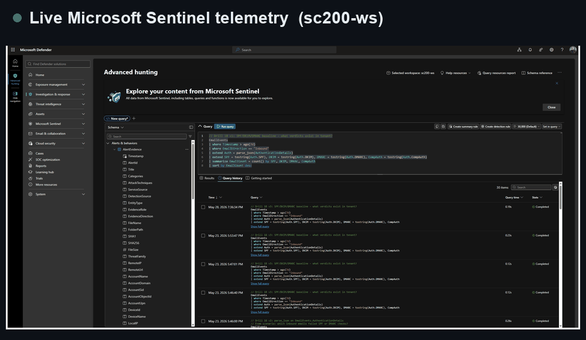
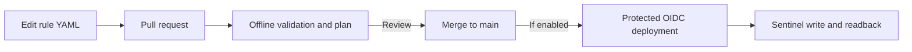
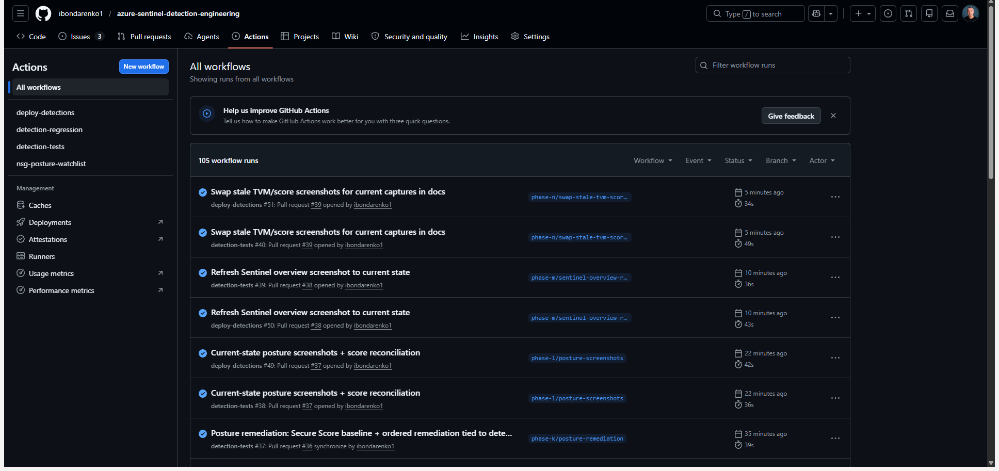
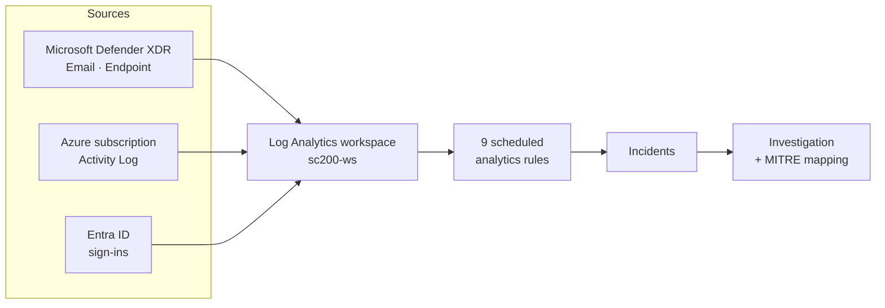
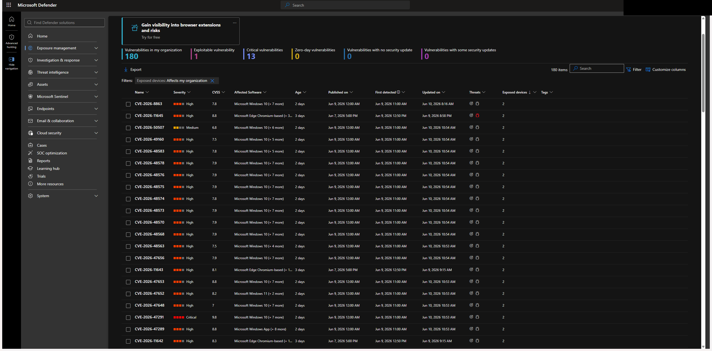
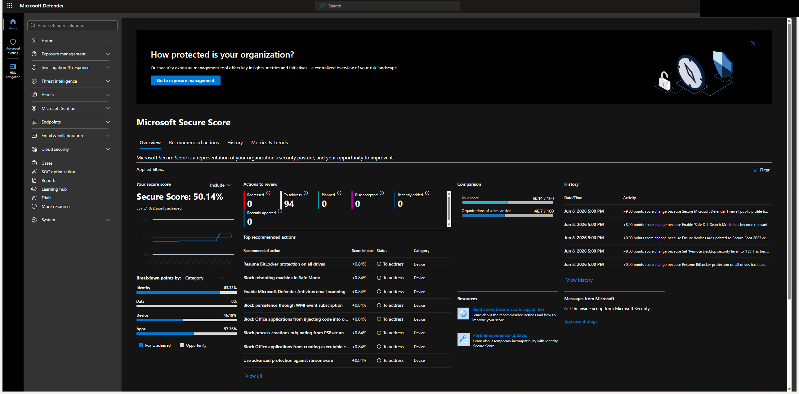
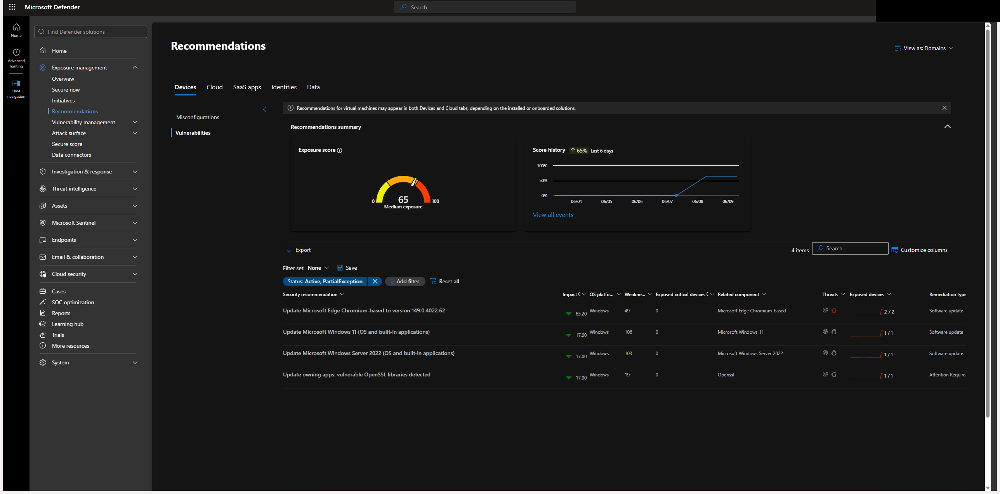

# Microsoft Sentinel Detection Engineering

Nine versioned Microsoft Sentinel analytics rules cover Azure Activity Log, Defender for Endpoint and Entra sign-ins. The repository includes KQL, synthetic event fixtures, a reviewable deployment plan, and incident evidence from a Sentinel and Defender XDR lab I operated.

| Start here | Inspect |
|---|---|
| Evaluate the rules without Azure | [Local checks](#quick-start) and [fixture coverage](tests/README.md) |
| Review or deploy a change | [Rule delivery and rollback](docs/03-cicd.md) |
| Start with a clean Azure lab | [Workspace bootstrap](docs/12-lab-bootstrap.md) |
| Review documented incidents | [Incident investigations](investigations/) and [historical validation results](validation/RESULTS.md) |



The last documented lab state is parked. The screenshots and incident writeups are historical. The local test suite and deployment plan work without that tenant. [Lab status](docs/04-validation.md#current-state)


The [ATT&CK layer](navigator/coverage-layer.json) documents technique coverage and gaps. The [results](validation/RESULTS.md) report what fired in the historical lab batch. Per-rule figures and their limits are in [metrics.yaml](detections/metrics.yaml).

---

## Quick start

Python 3.12 and the package in `requirements.txt` are enough to validate the catalog and inspect deployment payloads.

```bash
git clone https://github.com/ibondarenko1/azure-sentinel-detection-engineering
cd azure-sentinel-detection-engineering
python -m pip install -r requirements.txt
python cicd/validate-detections.py
python cicd/deploy-detections.py plan --output sentinel-plan.json
```

To run the actual KQL against synthetic telemetry, start the [local Kusto emulator](tests/README.md). The test guide lists the signals covered and explains where fixtures stand in for a workspace dependency. See [CONTRIBUTING](CONTRIBUTING.md) for the PR workflow.

## Why this exists

The catalog includes a sequence rule for a privilege grant followed by a deployment and a rule that correlates an NSG change with Azure Resource Graph posture. The fixtures exercise rule logic, while the investigation notes show how alerts from earlier lab runs were triaged.

## Detection-as-Code

Pull requests validate the catalog and test KQL without Azure. The `validate` job publishes a JSON plan with rule payloads, required tables and watchlists. `diff` compares the desired rules with an Azure workspace. When deployment is enabled, the `main` branch writes changed rules from a protected OIDC environment and verifies the managed settings by GUID.



- Source of truth: [`detections/rules/*.yaml`](detections/rules) · Pipeline: [`.github/workflows/deploy-detections.yml`](.github/workflows/deploy-detections.yml) · Deployer/validator: [`cicd/`](cicd) · Details: [docs/03-cicd.md](docs/03-cicd.md)



[PR #1](https://github.com/ibondarenko1/azure-sentinel-detection-engineering/pull/1) records the historical workflow applying the DET-001 threshold change from 10 to 8 to the lab workspace.

## Architecture




## Detection catalog

| ID | Detection | Severity | MITRE tactic | Technique |
|----|-----------|----------|--------------|-----------|
| [DET-001](detections/DET-001-failed-activity-log-spike.md) | Failed Activity Log operations spike | Medium | Discovery | [T1087](https://attack.mitre.org/techniques/T1087/) Account Discovery |
| [DET-002](detections/DET-002-nsg-rule-modified.md) | Network Security Group rule modified | Medium | Defense Impairment | [T1686.001](https://attack.mitre.org/techniques/T1686/001/) Cloud Firewall |
| [DET-003](detections/DET-003-rbac-role-assignment-changes.md) | RBAC role assignment changes | Medium | Privilege Escalation / Persistence | [T1098](https://attack.mitre.org/techniques/T1098/) Account Manipulation |
| [DET-004](detections/DET-004-mass-resource-deletion.md) | Mass resource deletion | **High** | Impact | [T1485](https://attack.mitre.org/techniques/T1485/) Data Destruction |
| [DET-005](detections/DET-005-suspicious-deployment-non-owner.md) | Suspicious resource deployment by non-owner | Medium | Persistence | [T1098](https://attack.mitre.org/techniques/T1098/) Account Manipulation |
| [DET-006](detections/DET-006-lsass-credential-access.md) | LSASS credential access (endpoint) | **High** | Credential Access | [T1003.001](https://attack.mitre.org/techniques/T1003/001/) LSASS Memory |
| [DET-007](detections/DET-007-rbac-grant-then-deploy.md) | Privilege grant followed by deployment (correlation) | **High** | Privilege Escalation / Persistence | [T1098](https://attack.mitre.org/techniques/T1098/) Account Manipulation |
| [DET-008](detections/DET-008-signin-success-after-failures.md) | Successful sign-in after repeated failures (identity) | Medium | Credential Access / Initial Access | [T1110](https://attack.mitre.org/techniques/T1110/) Brute Force, [T1078](https://attack.mitre.org/techniques/T1078/) Valid Accounts |
| [DET-009](detections/DET-009-nsg-opened-inbound-any.md) | Change to an NSG security rule listed as open inbound from Any (ARG) | **High** | Defense Impairment | [T1686.001](https://attack.mitre.org/techniques/T1686/001/) Cloud Firewall |


## Results

The incident queue below shows results from the historical lab runs.


The captured workspace had nine custom scheduled rules in addition to Microsoft's built-in Fusion rule. The screenshots record that earlier state. DET-008 has fixture evidence and its live incident evidence remains pending. The revised DET-009 resource-ID correlation also needs a fresh workspace witness.


Five incidents are written up as full investigations:
- [INV-01, Mass resource deletion (High)](investigations/INV-01-mass-resource-deletion.md)
- [INV-02, RBAC privilege escalation](investigations/INV-02-rbac-privilege-escalation.md)
- [INV-03, LSASS credential access (High)](investigations/INV-03-lsass-credential-access.md), endpoint, Incident #65
- [INV-04, NSG opened inbound from Any (High)](investigations/INV-04-nsg-opened-inbound.md), ARG content correlation (DET-009)
- [INV-05, Privilege grant then deployment (High)](investigations/INV-05-grant-then-deploy.md), multi-stage correlation (DET-007)

The [historical batch](validation/RESULTS.md) recorded five of five expected signals and zero false fires on its three benign scenarios. The DET-009 result used the earlier watchlist and applies to that version of the rule only.

## ATT&CK coverage

A coverage map with explicit gaps is more honest than a list of rules. The [ATT&CK Navigator layer](navigator/coverage-layer.json) ([how to load](navigator/README.md)) shows both:

| Covered by the catalog | Known gap, tracked as an issue |
|-------------------------|---------------------------------|
| T1087 Account Discovery (DET-001) | [T1530 Data from Cloud Storage](../../issues/12), data-plane detection |
| T1686.001 Cloud Firewall (DET-002 / DET-009) | [T1496 Resource Hijacking](../../issues/13), spend/mining anomaly |
| T1098 Account Manipulation (DET-003 / DET-005 / DET-007) | [T1526 Cloud Service Discovery](../../issues/14), strengthen heuristic |
| T1485 Data Destruction (DET-004) | |
| T1003.001 LSASS Memory (DET-006) | |
| T1110 Brute Force / T1078 Valid Accounts (DET-008) | |

The gaps are not static text. Each one is a live [`detection-gap` issue](../../issues?q=is%3Aissue+label%3Adetection-gap), so the roadmap is a clickable backlog.

**Why these rules and not others:** [docs/08, detection strategy and threat model](docs/08-detection-strategy.md) maps the catalog to a cloud kill chain and risk-ranks the gaps. **How a rule gets tuned:** [docs/09, a measured DET-005 tuning loop](docs/09-tuning-case-study.md) takes a rule from "fires on every write" to a measured zero false positives on the validation harness.

## Automated response (SOAR)

The highest-severity detection closes the loop from detect to respond. A Sentinel automation rule runs a [Logic App playbook](playbooks/mass-deletion-response) on every DET-004 (mass deletion) incident: it posts an enrichment comment with the recommended containment (disable the caller, lock the resource groups, restore, hunt). The playbook authenticates with its own **managed identity** straight to the ARM API, with no secrets and no external connector.

A second playbook extends the loop into **detect → respond → AI-investigate** with **Microsoft Security Copilot**: a [promptbook + Logic App](playbooks/copilot-triage) invokes a Copilot promptbook on the same DET-004 incident and posts an AI investigation summary as a comment. It is built and deploys without any compute units; the live AI-summary capture runs in a single cost-bounded (~$4) paid window and is not claimed until captured. Cost and teardown runbook: [docs/06](docs/06-security-copilot.md).

## Endpoint and vulnerability management

The detections start on the Azure control plane; this phase adds the endpoint plane. A Defender for Endpoint sensor on a Windows host feeds the same workspace, so the Detection-as-Code pipeline deploys an endpoint rule, [DET-006 LSASS credential access](detections/DET-006-lsass-credential-access.md), next to the control-plane rules. DET-006 is multi-source and witnessed: three credential-dump techniques were run against the sensor, the hardened host (LSASS RunAsPPL, AMSI, behavioral protection) prevented every one, and the rule fired on the resulting Defender alerts to raise an incident ([INV-03](investigations/INV-03-lsass-credential-access.md)). Defender Vulnerability Management adds a second input: a [hunting library](kql/hunting) that surfaces critical CVEs by exposed software, failed secure-configuration baselines, and vulnerable assets under active alert. The `DeviceTvm*` tables live only in Defender advanced hunting, so those correlations are hunts, not deployed rules, and the repo says where each query actually runs. Architecture and data flow: [docs/07](docs/07-endpoint-vulnerability-management.md).




## Posture remediation

The detections watch for attacks; this phase reads the tenant's own posture score and fixes what it
flags, then proves the number moved. The Defender for Cloud Secure Score baseline is pulled as a
[machine-readable snapshot](posture/snapshots/2026-06-10-baseline.json) by [collect-posture.ps1](posture/collect-posture.ps1),
so the before/after is a file diff, not a screenshot comparison. At baseline the score is **68.81%**
(21.33 / 31), and the per-control breakdown puts the entire 9.67-point gap in four controls
(encryption at rest, access and permissions, network access, auditing). The remediation is ordered by
blast radius, additive fixes first, and each item is mapped to the catalog rule that catches its
regression (storage exposure to DET-002 / DET-009, RBAC sprawl to DET-003 / DET-007, lost logging to
the whole catalog). Three fixes were applied this pass and verified at the resource level: the
security contact and alert notifications, diagnostic logging on both SOAR playbooks (+1 auditing),
and encryption at host on the sensor VM (+4 encryption at rest). Defender for Cloud re-evaluates and
recalculates the score over the following 24 to 72 hours, so the after-score is documented as a
follow-up rather than asserted now. Full method, ordered plan, and detection-linkage table:
[docs/10, posture remediation](docs/10-posture-remediation.md).





## SOC 2 control mapping

This work supports a recognized control framework, so the repo says where. Each part of the catalog
maps to a SOC 2 Trust Services Criterion: the nine-rule catalog and incidents to the monitor-and-respond
series (CC7.2 to CC7.4), the SOAR playbooks to incident response (CC7.4), the PR-gated Detection-as-Code
pipeline to change management (CC8.1), and the validation harness and posture before-and-after to control
operating effectiveness (CC4.1). It is framed as a mapping, not a compliance claim: this is one tenant I
operate, not an audited organization, so the document maps the technical control activities and is
explicit about the governance wrapper a real SOC 2 report needs that a detection repo does not carry.
Full criterion-by-criterion table and the how-it-reads-in-an-audit note:
[docs/11, SOC 2 control mapping](docs/11-soc2-control-mapping.md).

## Repository layout

```
detections/rules  rule source-of-truth (Sentinel YAML, deployed by CI)
detections/*.md   one card per rule: logic, MITRE, trigger, evidence
detections/metrics.yaml  per-detection historical observations and latency estimates
tests/            synthetic-log unit tests (Kusto emulator, fork-runnable)
validation/       live mixed-activity harness: benign + attack streams, measured TP/FP
cicd/ + .github   Detection-as-Code pipeline (deploy, validate, regression)
sigma/            vendor-neutral Sigma conversions (portable to any SIEM)
kql/              analytics-rule queries + hunting library
investigations/   end-to-end incident write-ups
simulations/      exact atomic-aligned trigger steps
navigator/        ATT&CK coverage layer (covered + gaps)
posture/          Secure Score baseline collector + JSON snapshots + remediation script
playbooks/        SOAR response (Logic App + automation rule)
docs/             architecture, methodology, cicd, validation, data-dictionary, endpoint+TVM, detection-strategy, tuning case study, posture remediation, SOC 2 control mapping
screenshots/      visual evidence
```

## Skills demonstrated

KQL · Microsoft Sentinel scheduled analytics rules · multi-stage correlation rules · Entra ID identity detection (SigninLogs) · allow-list watchlists (`_GetWatchlist`) · Azure Resource Graph watchlist refresh · Microsoft Defender XDR · Microsoft Defender for Endpoint · Defender Vulnerability Management (TVM) · advanced hunting (Device / DeviceTvm tables) · Microsoft Secure Score · Defender for Cloud posture remediation (CSPM, MCSB) · SOC 2 Common Criteria control mapping · Detection-as-Code (GitHub Actions, OIDC) · SOAR (Logic Apps automation rules) · Sigma (vendor-neutral) · Atomic Red Team validation · incident triage and investigation · MITRE ATT&CK mapping · Azure control-plane (Activity Log) monitoring.

## Contributing

[CONTRIBUTING.md](CONTRIBUTING.md) covers rule edits, KQL mirrors, fixture cases and the checks expected in a pull request.

## Credentials

Microsoft Certified: Security Operations Analyst Associate (SC-200).

## Disclaimer

An environment I operate, not a production tenant of any employer or third party. Detections are validated with controlled, self-reverted administrative actions against my own resources; no production systems and no third parties are involved. Tenant and subscription identifiers and PII are redacted in all screenshots.

## License

[MIT](LICENSE)
