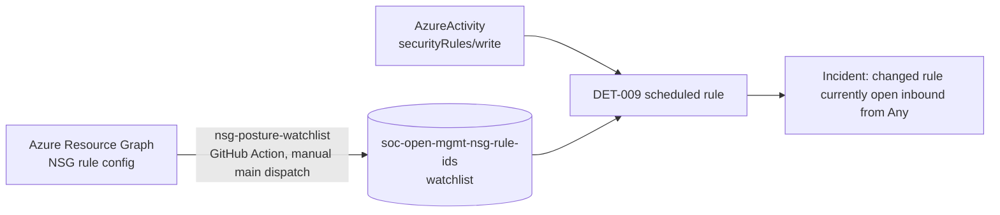

# DET-009, NSG security-rule change on a rule open inbound from Any

| | |
|---|---|
| **ID** | DET-009 |
| **Severity** | **High** |
| **Rule type** | Scheduled analytics rule (current-posture correlation; companion to DET-002) |
| **Status** | Enabled |
| **Data source** | `AzureActivity` + `soc-open-mgmt-nsg-rule-ids` watchlist (Azure Resource Graph) |
| **MITRE tactic** | Defense Impairment |
| **MITRE technique** | [T1686.001, Cloud Firewall](https://attack.mitre.org/techniques/T1686/001/) |

## Why this exists

[DET-002](DET-002-nsg-rule-modified.md) fires on *any* NSG `securityRules` change by a
non-automation principal, but the Activity Log does **not** carry the rule body, so DET-002 cannot
tell whether the change affected an exposed rule (documented data boundary). DET-009 correlates
the change with an Azure Resource Graph posture snapshot keyed by the **full child security-rule
resource ID**. The two rules are complementary: DET-002 = "an NSG rule was touched", DET-009 =
"that exact child rule is currently observed as inbound Allow-from-Any".

This is deliberately not phrased as proof that the write *opened* the rule. AzureActivity has no
before/after rule body, and ARG is refreshed separately. A successful match is a high-fidelity
triage signal; the responder must verify the before/after configuration before attributing the
exposure to this write.

## Data path



[GitHub Action](../.github/workflows/nsg-posture-watchlist.yml) runs an ARG query for
NSG rules with `access == Allow`, `direction == Inbound`, and `sourceAddressPrefix in (*, Internet,
0.0.0.0/0)`, and writes the full child resource IDs to the additive
`soc-open-mgmt-nsg-rule-ids` watchlist (OIDC, no secrets), scoped to the configured subscription.
This is the data DET-002 could not reach, brought into the workspace where a scheduled rule can
join it without treating an NSG display name as an identity.

The Action is manual-dispatch only and the job is restricted to `main`. It runs only when
`SENTINEL_WATCHLIST_REFRESH_ENABLED` is the literal `true`; the lab workspace is parked and the
watchlist write returns `AuthorizationFailed`. See [Current state](../docs/04-validation.md#current-state).

## Workflow guardrails and exact configuration

The workflow has no schedule. Its job condition is equivalent to:

```text
github.event_name == "workflow_dispatch"
and github.ref == "refs/heads/main"
and vars.SENTINEL_WATCHLIST_REFRESH_ENABLED == "true"
```

The job targets the GitHub environment `sentinel-watchlist`, keeps OIDC permissions at job scope,
and logs in with a dedicated principal. Define the opt-in variable at repository scope (so the
job gate can evaluate before the environment is entered) and the target values in that environment;
there are no hard-coded `RG` or `WS` defaults:

| Variable | Required value |
|---|---|
| `SENTINEL_WATCHLIST_REFRESH_ENABLED` | Repository variable; `true` only when an operator explicitly enables a refresh |
| `SENTINEL_WATCHLIST_CLIENT_ID` | Client ID of the dedicated watchlist-refresh OIDC principal, distinct from deployment identities |
| `SENTINEL_WATCHLIST_TENANT_ID` | Target Entra tenant GUID |
| `SENTINEL_WATCHLIST_SUBSCRIPTION_ID` | Target subscription GUID; ARG and the Watchlist PUT are scoped to it |
| `SENTINEL_WATCHLIST_RESOURCE_GROUP` | Resource group containing the Log Analytics workspace |
| `SENTINEL_WATCHLIST_WORKSPACE` | Log Analytics workspace name |

The refresh uses ARM Watchlists API `2025-09-01`. The ARG query explicitly scopes
`--subscriptions` and `--allow-partial-scopes false`, expands each NSG's security rules with an
explicit `limit 1000`, and refuses to publish when `result_truncated`/`resultTruncated`, a skip
token, missing `totalRecords`, a count mismatch, or a total greater than the returned rows
indicates an incomplete result.

## Detection logic

```kql
let openRuleIds = _GetWatchlist('soc-open-mgmt-nsg-rule-ids')
| extend SecurityRuleResourceId = tolower(replace_regex(tostring(SearchKey), @"/+$", ""))
| where isnotempty(SecurityRuleResourceId)
| project SecurityRuleResourceId;
AzureActivity
| where TimeGenerated > ago(1h)
| where OperationNameValue has "Microsoft.Network/networkSecurityGroups/securityRules"
| where OperationNameValue endswith "/write"
| where ActivityStatusValue == "Success"
| extend SecurityRuleResourceId = tolower(replace_regex(tostring(ResourceId), @"/+$", ""))
| where SecurityRuleResourceId contains "/networksecuritygroups/"
| where SecurityRuleResourceId contains "/securityrules/"
| where SecurityRuleResourceId in (openRuleIds)
| extend NsgName = tostring(split(SecurityRuleResourceId, "/")[8])
| extend CallerIp = tostring(parse_json(tostring(Properties_d.httpRequest)).clientIpAddress)
| project TimeGenerated, Caller, CallerIp, NsgName, SecurityRuleResourceId, OperationNameValue, ResourceId
```

`ResourceId` is normalized to lower case and stripped of trailing slashes, then compared with the
normalized `SearchKey` from `soc-open-mgmt-nsg-rule-ids`. The watchlist key is the complete child
ID (`.../networkSecurityGroups/<nsg>/securityRules/<rule>`), so another resource group or
subscription with the same NSG name cannot match. `Properties_d.resource` is retained only as a
provider-specific display field; it is not used as the join key.

## How to validate (authorized test tenant)

In an authorized test tenant, create or update an inbound `Allow` rule from `*` on a management
port, refresh the posture Action (or ARG-backed watchlist) and wait for the next rule run. Verify
that the alert contains the exact child resource ID. This validates correlation only; it does not
establish that the write itself created the exposure. Remove the test rule after validation.

## Expected result

Fires when a successful `securityRules/write` has a normalized child `ResourceId` present in
`soc-open-mgmt-nsg-rule-ids`; silent for a same-name NSG in another scope, an unrelated child
rule, a non-securityRules operation, or a failure (see `tests/fixtures/DET-009.json`).

## Tuning notes

- The watchlist is a periodically refreshed source of current posture; tune the ARG query (e.g.
  restrict to management ports 22/3389/5985, or exclude a documented jump-host rule) to shape
  fidelity.
- Pairs with DET-002: DET-002 catches the actor (any non-automation NSG change), DET-009 adds the
  current posture context for the exact child rule. Triage them together and verify before/after
  state before calling the write causal.

**Limitations.** A stale or failed refresh can miss a newly open rule; the workflow fails closed on
an incomplete ARG page and leaves the last known-good watchlist in place. Opening via a route table
/ Azure Firewall instead of an NSG is outside this rule, as is a rule excluded by a port restriction.

## Migration from the legacy name-keyed watchlist

`soc-open-mgmt-nsg-rules` is the legacy alias keyed by `NsgName`. It is not consumed by this
revision because display names are not unique. The workflow now publishes the additive
`soc-open-mgmt-nsg-rule-ids` alias with `SecurityRuleResourceId` as `itemsSearchKey`; retain the
legacy alias during rollout for rollback or other consumers, but do not copy its name-only rows
into the new watchlist. After the new alias is verified in the workspace, the legacy alias can be
retired separately.

## Source references

- Rule source: [`detections/rules/DET-009-nsg-opened-inbound-any.yaml`](rules/DET-009-nsg-opened-inbound-any.yaml)
- KQL mirror: [`kql/detections/DET-009.kql`](../kql/detections/DET-009.kql)
- ARG/watchlist refresh: [`nsg-posture-watchlist.yml`](../.github/workflows/nsg-posture-watchlist.yml)
- Offline correlation cases: [`tests/fixtures/DET-009.json`](../tests/fixtures/DET-009.json)
- [Azure Resource Graph query documentation](https://learn.microsoft.com/azure/governance/resource-graph/concepts/query-language)
- [Azure Resource Graph paging and truncation](https://learn.microsoft.com/azure/governance/resource-graph/concepts/paging-results)
- [Azure Activity Log schema](https://learn.microsoft.com/azure/azure-monitor/essentials/activity-log-schema)
- [Sentinel Watchlists Create or Update API 2025-09-01](https://learn.microsoft.com/rest/api/securityinsights/watchlists/create-or-update?view=rest-securityinsights-2025-09-01)

**Validation.** Fixture fire/silent in `tests/fixtures/DET-009.json` (run by `tests/run-detection-tests.py`
with the watchlist stubbed). [ATT&CK technique](https://attack.mitre.org/techniques/T1686/001/)
